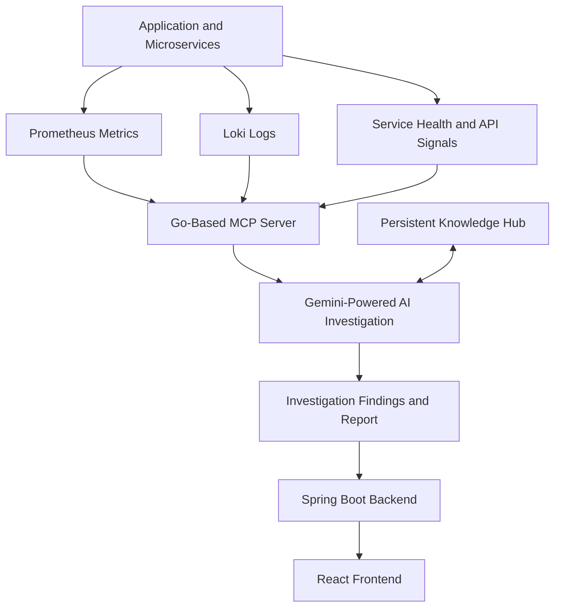

# SignalSleuth AI 🔎
### AI-Powered Incident Investigation & Persistent Operational Intelligence

**Investigate once. Learn from every incident. Troubleshoot smarter next time.**

SignalSleuth AI is an AI-powered observability and incident investigation platform that combines application logs, metrics, service health, and historical incident knowledge to help engineers investigate system failures.

Powered by **Google Gemini** and a custom **Go-based Model Context Protocol (MCP) server**, SignalSleuth AI gathers operational evidence through specialized tools, analyzes potential root causes, and stores investigation findings in a persistent Knowledge Hub. When similar incidents occur, historical findings can be retrieved to reduce repeated investigation effort.

The goal is to move beyond traditional monitoring dashboards toward an operational intelligence system that becomes more useful as incident knowledge accumulates.

---

## 🚨 The Problem

Modern distributed applications generate large volumes of logs, metrics, and service health signals. During an incident, engineers often need to:

- Manually correlate logs, metrics, and service failures.
- Investigate multiple services and dependencies to identify potential root causes.
- Repeat troubleshooting steps for incidents that resemble previous failures.
- Search scattered logs, dashboards, and incident notes for historical context.
- Reconstruct what happened and why after every failure.

Traditional observability tools help engineers understand what is happening. SignalSleuth AI aims to help them understand **why it may be happening and what previous investigations can teach them.**

## 💡 Our Solution

SignalSleuth AI brings together AI-powered investigation, observability tooling, and persistent incident knowledge.

- **Observability-Driven Investigation:** Collect relevant evidence from application metrics, logs, and service health.
- **AI-Powered Root-Cause Analysis:** Use Gemini to analyze the collected evidence and identify potential causes.
- **MCP-Based Tool Integration:** Expose observability and investigation capabilities through a custom Go-based MCP server.
- **Persistent Knowledge Hub:** Preserve useful investigation findings for future reference.
- **Historical Knowledge Reuse:** Retrieve relevant past findings when investigating similar incidents.
- **Controlled Failure Simulation:** Test the system against different failure scenarios and observe how services and telemetry respond.
- **Evidence-Based Reports:** Present investigation findings and supporting operational evidence to engineers.

## 🏗️ Architecture



### Architecture Components

| Component | Responsibility |
|---|---|
| React.js | User interface for incident investigation and results |
| Spring Boot | Backend APIs and application integration |
| Go MCP Server | Exposes observability and incident investigation tools |
| Google Gemini API | AI-powered evidence analysis and investigation |
| Prometheus | Metrics collection and querying |
| Grafana Loki | Log aggregation and querying |
| Grafana | Observability dashboards |
| PostgreSQL | Relational data storage |
| Redis | Caching and application data operations |
| RabbitMQ | Message queuing and asynchronous processing |
| Docker Compose | Containerized service orchestration |
| Nginx | Frontend serving and reverse proxy |
| Google Cloud Compute Engine | Cloud deployment environment |

## 🔄 How It Works

1. **Collect Signals:** Application services generate logs, metrics, and health information.
2. **Expose Investigation Tools:** The Go-based MCP server makes observability capabilities available to the AI investigation workflow.
3. **Investigate the Incident:** Gemini uses relevant tools to gather evidence and analyze the failure.
4. **Generate Findings:** The system produces an investigation report containing potential causes and supporting evidence.
5. **Preserve Knowledge:** Useful investigation findings are stored in the Knowledge Hub.
6. **Reuse Historical Context:** Subsequent investigations can retrieve relevant historical knowledge to avoid repeating work unnecessarily.

## 🛠️ Observability and Investigation Tools

The MCP server exposes tools for querying operational signals and investigating incidents, including:

| Tool | Purpose |
|---|---|
| `get_service_health` | Inspect service health |
| `get_error_rate` | Retrieve service error-rate information |
| `get_recent_errors` | Inspect recent application errors |
| `get_request_rate` | Examine request traffic |
| `get_latency` | Analyze request latency |
| `search_logs` | Search application logs |
| `investigate_incident` | Support a broader incident investigation |

These tools provide the AI investigation workflow with structured access to operational evidence.

## 🧪 Failure Simulation

SignalSleuth AI includes controlled failure scenarios for testing investigation behavior under different conditions.

Scenarios include:

- `normal` — Normal operating conditions
- `slow` — Simulated latency degradation
- `error_spike` — Increased application errors
- `payment_failure` — Payment-related failures
- `redis_failure` — Redis dependency failure
- `db_failure` — Database dependency failure

These scenarios help evaluate how failures affect service behavior, metrics, logs, and investigation results.

## 📊 Why SignalSleuth AI?

| Traditional Observability Workflow | SignalSleuth AI Approach |
|---|---|
| Engineers manually correlate signals | AI-assisted analysis of operational evidence |
| Incident investigation relies heavily on individual experience | Investigation findings can be preserved as shared knowledge |
| Similar incidents may require repeated analysis | Historical findings can support subsequent investigations |
| Logs and metrics are inspected separately | Multiple operational signals inform a unified investigation |
| Knowledge is often scattered across tools and notes | A persistent Knowledge Hub provides reusable incident context |

SignalSleuth AI complements observability platforms rather than replacing them. Its focus is connecting operational evidence with AI-assisted investigation and reusable knowledge.

## 🔮 Future Development

### Context-Aware Fix Intelligence

The next evolution of SignalSleuth AI is to determine whether a previously successful fix is relevant to the current incident.

Rather than relying on symptom similarity alone, the system could compare historical incidents against current service conditions, dependency health, and deployment or configuration changes.

Planned capabilities include:

- **Incident Context Comparison:** Identify meaningful differences between historical and current incidents.
- **Fix Relevance Assessment:** Determine whether a previously successful remediation is supported by the current evidence.
- **Change-Aware Investigation:** Incorporate deployment and configuration history to identify potential new causes.
- **Outcome-Based Learning:** Track whether previous findings and recommended fixes were confirmed or effective.
- **Improved Knowledge Retrieval:** Prioritize historical incidents based on contextual relevance rather than surface-level similarity.

**Vision:** Don't just remember how an incident was fixed. Understand whether that fix will work this time.

*These are planned enhancements, not claims about currently implemented functionality.*

## 🧰 Technology Stack

**Frontend**
- React.js

**Backend**
- Java
- Spring Boot

**AI and Tool Integration**
- Google Gemini API
- Model Context Protocol (MCP)
- Go

**Observability**
- Prometheus
- Grafana Loki
- Grafana

**Data and Messaging**
- PostgreSQL
- Redis
- RabbitMQ

**Infrastructure and Deployment**
- Docker
- Docker Compose
- Nginx
- Google Cloud Compute Engine

## 🚀 Getting Started

### Prerequisites

Before running the project, ensure you have the following installed:

- Git
- Docker and Docker Compose
- Google Gemini API key

Additional local tooling may be required if you choose to run individual services outside Docker.

### 1. Clone the Repository

```bash
git clone https://github.com/VanshikaaGuptaa/Observability-MCP.git
cd Observability-MCP
```

### 2. Configure Environment Variables

Configure the environment variables required by the services, including your Gemini API key.

Use the environment variable names and configuration format expected by the application. Keep secrets in local environment files or a secret manager, and never commit API keys or credentials to Git.

### 3. Start the Services

If the repository's Docker Compose configuration defines the complete application stack, run:

```bash
docker compose up --build -d
```

### 4. Verify the Deployment

Check the running containers:

```bash
docker compose ps
```

Inspect service logs if a container fails to start:

```bash
docker compose logs -f
```

**Note:** Required environment variables, exposed ports, and startup steps depend on the repository's current configuration. Refer to the relevant service configuration files for exact requirements.

## 🧪 Testing the Failure Scenarios

The application includes a failure-scenario control endpoint for testing supported scenarios.

Example request:

```bash
curl -X POST http://localhost:8080/api/admin/failure-scenario \
  -H "Content-Type: application/json" \
  -d '{"scenario":"db_failure"}'
```

Create a test order to generate application activity:

```bash
curl -X POST http://localhost:8080/api/orders \
  -H "Content-Type: application/json" \
  -d '{"product_id":1,"quantity":1}'
```

Change `db_failure` to another supported scenario to test different behaviors. These example requests assume the service is running locally on the specified port and that the endpoint configuration matches your deployment.

## 🔐 Security Notes

- Never commit API keys, credentials, or production secrets.
- Restrict access to administrative failure-simulation endpoints.
- Avoid exposing internal observability endpoints publicly without authentication and appropriate network controls.
- Validate AI-generated findings before using them to make operational changes.
- Use controlled test environments for failure simulation.

## 🎯 Project Goals

SignalSleuth AI aims to make incident investigation more consistent and less repetitive by combining:

- Observability-driven diagnosis
- AI-assisted reasoning
- MCP-based tool integration
- Persistent incident knowledge
- Historical investigation reuse
- Continuous improvement through future outcome-aware learning

## 🤝 Contributing

Contributions, ideas, and feedback are welcome.

Potential areas for contribution include:

- Additional observability integrations
- Better historical incident matching
- Investigation quality evaluation
- Knowledge retrieval improvements
- New controlled failure scenarios
- Deployment and configuration change correlation

For significant changes, open an issue to discuss the proposed approach before submitting a pull request.

## 📄 License

Add a `LICENSE` file to specify how this project may be used, modified, and distributed.

---

**SignalSleuth AI — Turning incident investigations into reusable operational intelligence.**